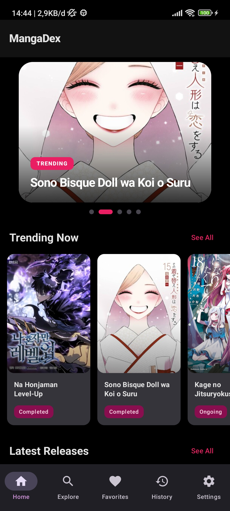
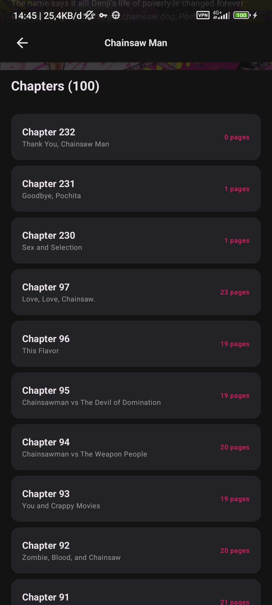

<div align="center">

# MangaDex for Android

**A modern, native Android client for the MangaDex API — built with Kotlin and Jetpack Compose.**

Discover trending and freshly released manga, search the full catalogue, bookmark your favorites,
and jump straight back into the chapter you were reading.

[](https://developer.android.com)
[](https://kotlinlang.org)
[](https://developer.android.com/jetpack/compose)
[](https://developer.android.com/about/versions)
[](https://api.mangadex.org/docs/)
[](#-license)

</div>

---

## 📖 About

**MangaDex for Android** is an unofficial, community-built client that brings the MangaDex experience
to a native Android app. It is a fully offline-aware reading companion: remote data is fetched from the
public MangaDex REST API through Retrofit, while favorites, reading history, and search history are
persisted locally with Room — so your library survives network outages and app restarts.

The app follows **MVVM with a layered (data / domain / ui) architecture**, uses **Hilt** for dependency
injection end-to-end, is written **100% in Kotlin**, and is rendered entirely with **Jetpack Compose**
and **Material 3** — including edge-to-edge layout, dynamic theming and shared-element transitions.

> ⚠️ **Unofficial project.** Not affiliated with, endorsed by, or sponsored by MangaDex.
> All manga metadata and images are served by the public [MangaDex API](https://api.mangadex.org/docs/).

---

## ✨ Features

| | Feature |
|---|---|
| 🎬 | **Animated splash screen** that hands off to the main shell |
| 🏠 | **Home feed** with a hero *trending* banner plus *Trending Now* and *Latest Releases* carousels, each with a **See all** drill-down |
| 🔎 | **Explore & search** manga by title, with **recent search history** persisted in Room (single-query delete / clear all) |
| 📚 | **Manga detail** — high-resolution cover, localized title, author & artist, description, tags, and the full chapter list |
| ❤️ | **Favorites** — bookmark any manga and manage your personal library offline |
| 🕘 | **Reading history** — automatically records the last chapter you opened per manga (one entry per title, always up to date) |
| 📖 | **Continuous vertical reader** — webtoon-style scrollable pages streamed from *MangaDex@Home*, with full-width image scaling |
| 🎨 | **Theme control** — System / Light / Dark appearance setting, applied instantly across the app |
| ✨ | **Polished UX** — shimmer loading placeholders, shared-element transitions between list and detail, graceful empty & error states |
| 🧭 | **Bottom navigation** with state-preserving navigation via Navigation Compose |

---

## 🖼 Screenshots

<div align="center">
  
  
  
  
</div>

---

## 🏗 Architecture

```
com.santoso.mangadex
├── MangaDexApp.kt            # @HiltAndroidApp application entry point
├── MainActivity.kt           # Single-activity host: Scaffold + NavHost + SharedTransitionLayout
├── data
│   ├── local                 # Room: MangaDatabase, MangaDao, entities (favorites / history / search history)
│   ├── remote                # Retrofit: MangaDexApi contract + BASE_URL
│   └── repository            # MangaRepository — single source of truth (remote + local)
├── domain
│   └── model                 # API DTOs: MangaData, ChapterData, AtHomeResponse, …
├── di                        # Hilt modules: AppModule, NetworkModule, DatabaseModule
└── ui
    ├── navigation            # Type-safe Screen routes + bottom navigation items
    ├── screens               # Splash, Home, Explore, Favorites, History, MangaList, Detail, Reader, Settings
    ├── components            # Reusable Compose components (cards, section headers, shimmer, …)
    ├── viewmodel             # One ViewModel per screen, exposing StateFlow
    └── theme                 # Material 3 color scheme, typography, theming
```

**Data flow:** `Compose Screen → ViewModel (StateFlow) → MangaRepository → Retrofit (MangaDex API) / Room (local cache)`

**Design principles applied**

- **Single source of truth** — every screen reads from `MangaRepository`; nothing talks to Retrofit or Room directly.
- **Unidirectional data flow** — ViewModels expose immutable `StateFlow`s; composables are stateless consumers.
- **Constructor injection everywhere** — Hilt provides the API service, database, DAO and repository as singletons.
- **Lifecycle-aware** — coroutines are scoped to `viewModelScope`; UI state survives configuration changes.

### MangaDex endpoints consumed

| Endpoint | Purpose |
|---|---|
| `GET /manga` | Catalogue listing — trending, latest, top-rated, recently added, and title search |
| `GET /manga/{id}` | Manga detail with `cover_art`, `author` and `artist` relationships |
| `GET /manga/{id}/feed` | Chapter feed for a manga |
| `GET /at-home/server/{chapterId}` | Page image URLs served by MangaDex@Home |

Requests are attired with a descriptive `User-Agent`, as required by the MangaDex API guidelines, and
gated to `safe` / `suggestive` content ratings by default.

---

## 🧰 Tech Stack

| Layer | Technology | Version |
|---|---|---|
| Language | Kotlin | 2.2.10 |
| Build | Android Gradle Plugin · KSP | 9.2.1 · 2.2.10-1.0.31 |
| UI | Jetpack Compose (BOM) · Material 3 · Material Icons Extended | 2026.02.01 |
| Navigation | Navigation Compose | 2.9.8 |
| DI | Hilt (+ Hilt Navigation Compose) | 2.60.1 |
| Networking | Retrofit · OkHttp Logging Interceptor · Gson | 3.0.0 · 5.4.0 |
| Persistence | Room (runtime · ktx · compiler via KSP) | 2.8.4 |
| Images | Coil | 2.7.0 |
| Android | compileSdk 37 · targetSdk 36 · minSdk 29 | — |

---

## 🚀 Getting Started

### Prerequisites

- **Android Studio** (latest stable, Koala or newer recommended)
- **JDK 17+**
- **Android SDK** with API 37 platform installed

### Build & run

```bash
# 1. Clone
git clone https://github.com/ekosanto2008/MangaDex.git
cd MangaDex

# 2. Debug build
./gradlew assembleDebug          # macOS / Linux
gradlew.bat assembleDebug        # Windows

# 3. Install on a connected device or emulator
./gradlew installDebug
```

Or simply open the project in Android Studio and press **Run ▶**.

> The MangaDex API is public and **no API key is required**. `local.properties` is generated by
> Android Studio and intentionally excluded from version control.

---

## 🗺 Roadmap

- [ ] Paginated (infinite-scroll) catalogue & search results
- [ ] Multi-language chapter selection and language filter
- [ ] Reader gestures — pinch-to-zoom, double-tap, page counter, left-to-right mode
- [ ] "Continue reading" resume from the exact last page
- [ ] Offline chapter downloads
- [ ] Search filters (genre, demographic, status, content rating)
- [ ] Persisted reader preferences and per-manga read markers
- [ ] Unit & UI test coverage

---

## 🙌 Credits

- **Developed by [Eko Santoso](https://github.com/ekosanto2008)**
- **Powered by the [MangaDex API](https://api.mangadex.org/docs/)**
- Built on the open-source Android ecosystem: Jetpack Compose, Hilt, Room, Retrofit, OkHttp, Coil, Navigation Compose

If this project is useful to you, consider giving it a ⭐ — it genuinely helps.

---

## 📄 License

This project is licensed under the **MIT License** — see [LICENSE](LICENSE) for details.

```text
MIT © 2026 Eko Santoso
```

<div align="center">

**MangaDex for Android** — built with ❤️ and Kotlin.

</div>
